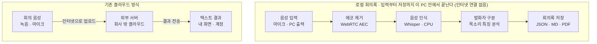

# 회의 내용을 밖으로 내보내지 않는 회의록 작성기

회의 내용을 외부 서버로 보내지 않고, 녹음 파일도 남기지 않으면서 회의록을 텍스트로 얻기 위해 PC 한 대 안에서만 동작하는 음성 텍스트 변환기 **로컬 회의록(LocalMinutes)**을 만들었다.

## 왜 회의 내용을 텍스트로 남기려 하는가

회의가 끝나면 "그때 누가 뭐라고 했더라"를 두고 기억이 엇갈린다. 손으로 받아 적는 사람은 회의에 제대로 참여하기 어렵고, 적는 사람의 해석이 들어간 요약만 남는다.

회의 내용을 발언 단위의 텍스트로 남기면 세 가지가 쉬워진다.

- 결정 사항과 담당자를 나중에 다시 확인하기
- 참석하지 못한 사람에게 공유하기
- 검색하고, 복사해 보고서·요약의 재료로 쓰기

그래서 많은 사람이 이미 여러 도구로 회의를 텍스트로 바꾸고 있다.

## 현재 많이 쓰는 방법

회사에서 회의를 텍스트로 바꾸는 방법은 크게 세 가지다. 녹음 파일을 변환 서비스에 올리거나, 운영체제·휴대폰의 음성 인식을 쓰거나, 화상회의 프로그램의 전사 기능을 켜는 방식이다.

| 방법 | 사용 방식 | 음성이 처리되는 곳 | 결과가 남는 곳 |
| --- | --- | --- | --- |
| 네이버 클로바노트 | 앱으로 녹음하거나 녹음 파일을 올려 텍스트·화자 구분·요약을 받음 | 네이버 서버 | 네이버 계정 |
| 윈도우 음성 입력(Win+H) | 메모장 등에서 음성 입력을 켜고 말하면 글자로 입력 | 마이크로소프트 온라인 음성 인식 | 사용자 PC |
| 갤럭시 음성 녹음·통화 녹음의 텍스트 변환 | 휴대폰으로 회의나 통화를 녹음한 뒤 녹음 파일을 텍스트로 변환 | 기기·설정에 따라 삼성 서버 또는 휴대폰 | 개인 휴대폰, 클라우드 백업 |
| 줌(Zoom) 녹화·전사·AI Companion | 클라우드 녹화를 켜면 오디오 전사본과 회의 요약을 생성 | 줌 서버 | 줌 계정 |
| Microsoft Teams 녹음·전사 | 회의 중 전사를 시작하면 발언자별 자막과 전사본 생성 | 마이크로소프트 서버 | OneDrive·SharePoint |
| Google Meet 녹화·스크립트 | 회의 중 스크립트나 회의록 작성을 켜면 문서가 생성 | 구글 서버 | Google Drive |
| 다글로, 비토 등 국내 받아쓰기 서비스 | 녹음 파일을 업로드하거나 앱으로 녹음해 변환 | 각 서비스 서버 | 각 서비스 계정 |

모두 쓰기 쉽고 인식 품질도 좋다. 그러나 대부분 회의 음성을 회사 밖 서버에서 처리한다는 공통점이 있다. 각 서비스의 세부 처리 방식은 요금제와 설정에 따라 다르다.

## 기존 방법의 두 가지 문제

### 1. 회의 내용이 외부 클라우드를 거친다

회의 음성은 회사 밖 서버로 전송되고, 텍스트로 바뀐 뒤 다시 내 화면으로 돌아온다. 신제품 일정, 인사, 고객사 정보, 계약 조건 같은 내용이 짧게나마 회사 밖에 나가는 것이다.

- 회사 보안 정책상 외부 클라우드 업로드가 금지된 자료일 수 있다.
- 음성과 텍스트가 서비스에 얼마나 보관되는지, 서비스 개선에 쓰이는지를 사용자가 직접 통제하기 어렵다.
- 개인 휴대폰이나 개인 계정에 회사 회의 녹음이 쌓이면 퇴사·분실 때 회수할 방법이 없다.

### 2. 상대방의 동의 없이 녹음된다

휴대폰을 책상에 올려두고 녹음하면 다른 참석자는 녹음 사실을 모르는 경우가 많다. 회의 내용과 함께 참석자의 목소리 자체가 파일로 남고, 이 파일은 쉽게 복사·전달된다.

국내법상 대화 당사자가 녹음하는 것은 통신비밀보호법 위반은 아니다. 하지만 동의 없는 녹음은 동료 간 신뢰를 해치고, 목소리 파일이 외부 서비스에 저장되면 개인정보 처리 문제까지 생긴다. Teams처럼 녹음 시작을 참석자에게 자동으로 알리는 도구도 있지만, 휴대폰 녹음에는 그런 장치가 없다.

## 해결책: 독립형 음성 텍스트 변환기 ‘로컬 회의록’

로컬 회의록(LocalMinutes)은 인터넷 연결 없이 Windows PC 한 대에서 음성 인식부터 문서 생성까지 모두 처리하는 프로그램이다. 음성 인식 모델과 발화자 분석 모델을 프로그램 안에 넣어 두었기 때문에, 회의 음성이 PC 밖으로 나갈 일이 없다.

두 문제에 대한 답은 다음과 같다.

- **외부 전송**: 음성·텍스트·로그 모두 PC 안에만 남는다. 프로그램은 외부 전사 서비스, 자동 업데이트, 오류 자동 보고를 쓰지 않는다.
- **녹음 파일**: 기본 설정에서는 음성 파일을 저장하지 않고 텍스트만 남긴다. 목소리 특징값도 처리 중 메모리에만 두고 파일에 기록하지 않는다.

다만 회의를 받아 적는 도구인 점은 같으므로, 기록을 시작할 때 참석자에게 알리는 것이 좋다. 이 프로그램은 동의 절차를 대신하지 않고, 녹음 파일과 외부 저장이라는 위험을 없앤다.

기존 방식은 음성이 회사 밖 서버를 거쳐 돌아오지만, 로컬 회의록은 음성 입력부터 회의록 저장까지 한 PC 안에서 끝난다.

## 특징

### 설치 없이 압축만 풀면 실행된다

약 419 MiB의 ZIP 파일 하나에 프로그램, 음성 인식 모델, 발화자 분석 모델, 한글 글꼴이 모두 들어 있다. 압축을 풀고 `MeetingTranscriber.exe`를 실행하면 되며, Python 설치나 모델 다운로드가 필요 없다. 모델이 없으면 외부 서비스로 대체하지 않고 실행을 멈춘다.

### 마이크와 PC 출력을 함께 받아 적는다

- **마이크(MIC)**: 같은 회의실에 있는 참석자들의 목소리
- **PC 출력(SYSTEM)**: 줌·Teams 같은 화상회의나 동영상에서 나오는 상대방 목소리

두 입력을 따로 켜고 끌 수 있고, 모든 발언에 어느 입력에서 들어왔는지 표시한다. 스피커 소리가 마이크로 다시 들어가 같은 말이 두 번 적히는 것을 에코 제거(AEC)로 줄인다.

### 발화자를 구분하고 이름을 붙일 수 있다

목소리 특징으로 발화자 1, 발화자 2를 자동으로 구분한다. 발화자 이름을 바꾸면 이전·이후 발언에 모두 반영되고, 잘못 인식한 문장이나 발화자 배정은 더블클릭으로 고친다.

### 회의가 끝나면 문서가 나온다

**종료 및 저장**을 누르면 시간순 발언 기록이 Markdown과 PDF로 저장된다. PDF에는 한글 글꼴이 들어가고, 나중에 세션 파일을 다시 열어 수정한 뒤 다시 뽑을 수 있다.

### 인식 모드를 고를 수 있다

| 모드 | 음성 인식 모델 | 한 번에 보는 음성 | 성격 |
| --- | --- | --- | --- |
| 정확도 우선(기본) | Whisper small | 최대 약 12초 | 더 정확하지만 표시가 늦다 |
| 속도 우선 | Whisper base | 최대 약 6초 | 빠르게 표시되지만 오인식이 늘다 |

같은 단어가 비정상적으로 길게 반복되는 인식 오류를 감지하면 한 번 다시 인식하고, 그래도 안 되면 **인식 확인 필요**로 표시한다.

### 로그에도 회의 내용을 남기지 않는다

문제 확인용 실행 로그에는 처리 시간·오류 종류 같은 상태만 기록한다. 대화 원문, 회의 제목, 발화자 이름, 장치 이름은 남기지 않는다. 검증 중 프로그램의 네트워크 연결 시도는 0건이었고, 필요하면 이 프로그램만 인터넷을 막는 방화벽 규칙도 설정할 수 있다.

## 사용 화면과 변환 사례

> [이미지 1: 기록 중 화면 — 입력 장치 선택, 실시간 전사, 발화자 목록]

> [이미지 2: 발화자 이름 변경과 발언 수정]

> [이미지 3: 저장된 PDF 회의록]

> [이미지 4: 변환 사례 — 실제 발언과 인식 결과 비교]

## 한계

모델을 프로그램에 내장하고 일반 사무용 PC의 CPU만으로 돌려야 하므로, 대형 서버에서 돌아가는 클라우드 서비스보다 성능이 낮을 수밖에 없다.

- **작은 모델**: PC에 넣고 CPU로 돌릴 수 있는 Whisper small·base 모델을 쓴다. 크기를 줄이려 INT8로 양자화했다. 대형 모델을 쓰는 클라우드 서비스보다 전문 용어·고유명사·빠른 말의 오인식이 많다.
- **지연**: 음성을 최대 약 12초씩 모아 처리하므로 글자가 말보다 늦게 나타난다. 개발 PC에서 18.52초 한국어 음성의 인식 계산에 약 6.9초가 걸렸다. 느린 PC나 여러 사람이 동시에 길게 말하는 회의에서는 처리가 밀릴 수 있다.
- **발화자 구분**: 발화자 모델은 중국어 데이터로 학습한 모델이다. 사람 수를 잘못 세거나 같은 사람에게 새 번호를 붙일 수 있고, 겹쳐서 말한 목소리는 분리하지 못한다.
- **환경**: Windows 11 x64에서만 확인했다. 패키지가 압축 해제 후 약 659 MiB로 크다.
- **요약 기능 없음**: 발언을 시간순으로 정리할 뿐, 회의 요약이나 결정 사항 추출은 하지 않는다. 요약까지 로컬에서 하려면 더 큰 언어 모델이 필요하다.

현재 버전(v0.1.3)은 현장 시험용이다. 실제 여러 사람이 참석하는 회의에서의 정확도와 장시간 사용 시 지연은 아직 검증하지 않았다.

## 맺음말

로컬 회의록은 인식 품질과 속도를 일부 포기하는 대신, 회의 내용이 PC 밖으로 나가지 않는다는 확실함을 택한 도구다. 보안이 중요한 회의에서는 이 교환이 충분히 가치가 있다고 본다. PC 성능과 로컬 모델이 좋아질수록 이 차이는 줄어들 것이다.
